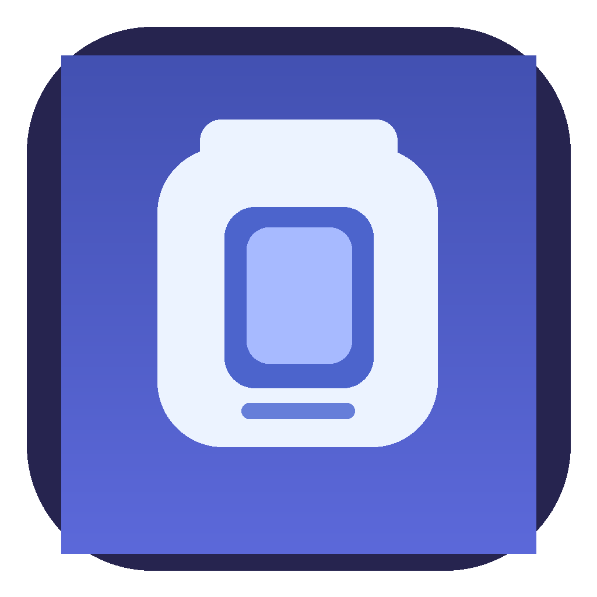

<p align="center">
  
</p>

<h1 align="center">OpenBottle</h1>

<p align="center">
  Apple Silicon Mac'lerde Windows oyunlarını ve programlarını çalıştırmak için sade, Türkçe bir arayüz.<br>
  Wine Staging ve Apple Game Porting Toolkit (GPTK) üzerine kurulu.
</p>

<p align="center">
  
  
  
</p>

---

## Neler yapıyor?

- **Şişeler:** Her program ya da oyun için ayrı bir Wine ortamı (prefix). Şişeler birbirini etkilemez.
- **Steam desteği:** Steam, Wine Staging üzerinde çalışır. Steam'in siyah ekran sorununa karşı geri alınabilir bir onarım aracı var.
- **DirectX 12 oyunlar:** Steam'in “Oyna” butonu DX12 oyunlarda hata verebiliyor. OpenBottle bu oyunları ayrı bir GPTK ortamında başlatır.
- **Oyunları Bul:** Steam kütüphaneni tarar ve her oyun için tek bir kart gösterir. Gereksiz `.exe` listesi çıkmaz.
- **Oyun kapakları:** Kartlarda oyunun gerçek Steam kapağı görünür, kapak bulunamazsa sade bir simge gösterilir.
- **Türkçe ve sade arayüz:** Ana Sayfa, Kütüphane, Şişeler. Gelişmiş ayarlar ancak gerektiğinde karşına çıkar.

## Gereksinimler

| | |
|---|---|
| **Mac** | Apple Silicon (M1 ve sonrası) |
| **macOS** | 13 Ventura veya daha yeni |
| **Derlemek için** | Xcode veya Xcode Command Line Tools |
| **Wine Staging** | Homebrew ile ya da `/Applications/Wine Staging.app` olarak kurulu olmalı |
| **GPTK** (DX12 oyunlar için) | `/Applications/Game Porting Toolkit.app` konumunda olmalı |
| **Rosetta 2** | Wine'ın çalışması için gerekli |

> OpenBottle Wine, GPTK, D3DMetal ya da Steam'i **içinde getirmez**. Lisans gereği bunları kendin kurman gerekiyor; OpenBottle onları Mac'inde bulup kullanır.

Steam siyah ekran onarımı ilk kez kullanıldığında Homebrew üzerinden `mingw-w64` kurmak isteyebilir. Bunu yapmadan önce senden onay ister.

## Kurulum (kaynaktan derleme)

```bash
git clone https://github.com/sivaskangali58-king/OpenBottle.git
cd OpenBottle
./scripts/build-macos.sh
open dist/OpenBottle.app
```

Betik `dist/` klasörüne `OpenBottle.app` ile `OpenBottle-0.8.9.dmg` dosyalarını oluşturur. İstersen `.app`'i Uygulamalar klasörüne sürükleyebilirsin.

### “Geliştirici doğrulanamadı” uyarısı

Uygulama Apple tarafından imzalanmadığı ve notarize edilmediği için macOS ilk açılışta uyarı verebilir. Uyarı çıkarsa:

1. **Sistem Ayarları → Gizlilik ve Güvenlik** bölümünü aç
2. Sayfanın altındaki OpenBottle uyarısının yanında **Yine de Aç**'a bas

## Test edilenler

Test makinesi MacBook Air M4 (16 GB):

- ✅ Steam açılıyor (siyah ekran onarımıyla birlikte)
- ✅ *The Guild – Europa 1410* demosu GPTK ile oynanabiliyor, düşük ayarlarda yaklaşık 25 FPS

Oyun uyumluluğu ve performans oyundan oyuna çok değişir. Yüksek FPS beklentisiyle kurma; bu bir deneme projesi.

## Verilerin nerede?

Şişeler, Steam kurulumu, oyunlar ve kapak görselleri burada durur:

```
~/Library/Application Support/OpenBottle/
```

⚠️ Bu klasörü silersen **tüm şişelerin ve oyunların gider.** OpenBottle güncellemeleri bu klasöre dokunmaz.

## Geliştirme

```bash
swift test
```

Proje yapısı:

```
Sources/OpenBottle/        SwiftUI arayüzü, Wine başlatıcı, Steam onarım ekranı
Sources/OpenBottleCore/    Şişe modeli, kayıt, oyun tarama, Wine/GPTK bulma, Steam mantığı
Tests/                     Çekirdek testleri ve betik testleri
scripts/                   Derleme ve Steam onarım betikleri
```

Sürüm notları için [CHANGELOG.md](CHANGELOG.md) dosyasına bak.

## Lisans ve teşekkür

OpenBottle [MIT lisansı](LICENSE) ile dağıtılır.

Steam siyah ekran onarımı fikri [notpop/steam-on-m1-wine](https://github.com/notpop/steam-on-m1-wine) projesinden esinlenmiştir. Ayrıntılar [THIRD_PARTY_NOTICES.md](THIRD_PARTY_NOTICES.md) dosyasında.

Steam, Valve Corporation'ın ürünüdür. Game Porting Toolkit ve D3DMetal Apple'a aittir. OpenBottle; Valve, Apple veya CodeWeavers ile bağlantılı değildir ve onlar tarafından desteklenmez. Oyun kapakları ve logolar hak sahiplerine aittir.
